<div align="center">

# Qubit Rush

### Solve quantum puzzles, one gate at a time

[](https://github.com/MariaAlejandraBoadaRodriguez/QUBIT-RUSH/actions/workflows/android-emulator.yml)


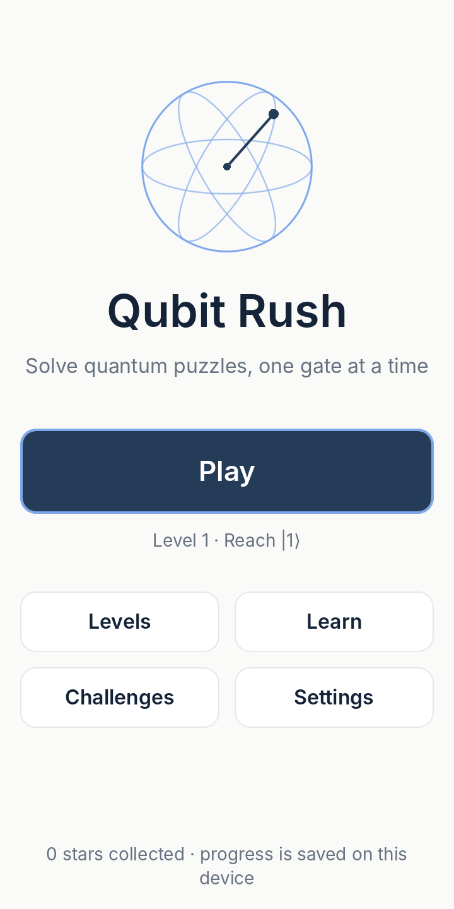

</div>

**Qubit Rush** is a portrait Android puzzle game about real quantum circuits. You start with qubits in a known state, place quantum gates on a circuit, press **Run**, and try to reach a target state. Under the hood a small statevector simulator applies every gate to complex amplitudes, so phase, interference, measurement and entanglement behave exactly as they do in physics. It is built for curious players from age 10 up, needs no account and no internet connection, and asks for nothing in return except attention.

<div align="center">
<table>
  <tr>
    <td align="center">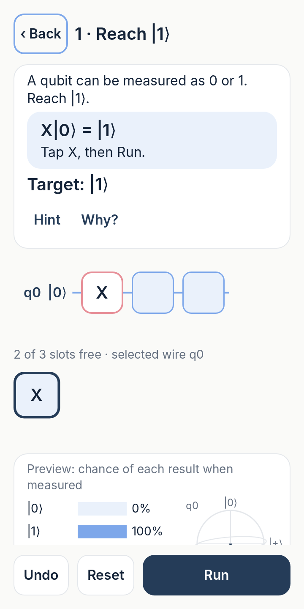<br><sub>1 · Place an X gate</sub></td>
    <td align="center">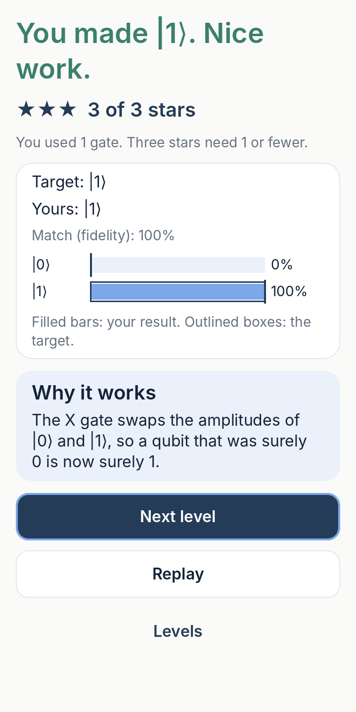<br><sub>2 · Run and compare with the target</sub></td>
    <td align="center">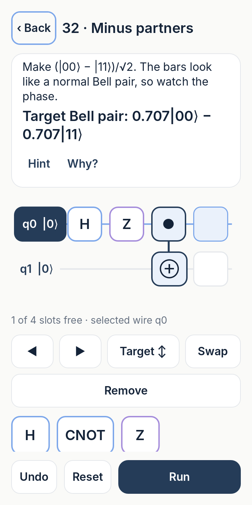<br><sub>3 · Build entangled Bell states</sub></td>
  </tr>
</table>
</div>

---

## Why I built this

I wanted a way to let anyone *touch* quantum computing instead of only reading about it. Most popular explanations reduce a qubit to "a coin that is heads and tails at the same time", a picture that breaks the moment you try to explain interference. In Qubit Rush every result comes from the real mathematics, so the game can never teach something that a physicist would have to un-teach later. I designed it for a curious 10-year-old and an equally curious 30-year-old: short sentences, no mascots, no baby talk, and an optional "Why?" panel for anyone who wants the deeper story. My goal is that players leave with correct intuitions about superposition, phase and entanglement, built one gate at a time.

---

## Screenshots

All images are real renders of the game (Godot Compatibility renderer, 720 × 1440 design canvas), captured from `reports/screenshots/`.

<table>
  <tr>
    <td align="center"><br><sub><b>Home.</b> One obvious Play button, no login.</sub></td>
    <td align="center">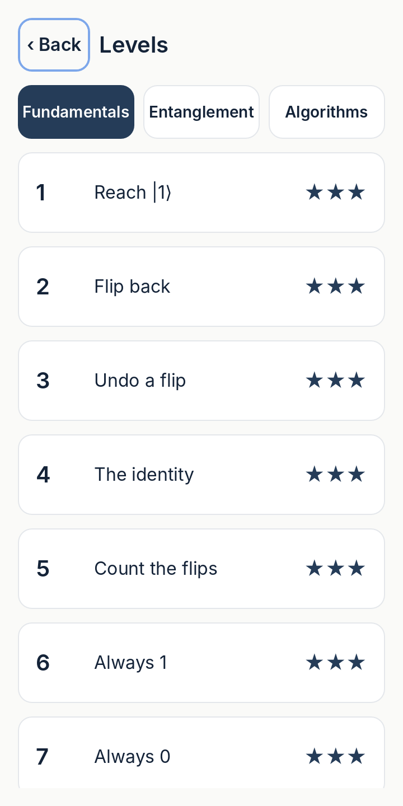<br><sub><b>Levels.</b> Three chapters with stars per level.</sub></td>
    <td align="center"><br><sub><b>Level 1.</b> One-line tutorial, circuit editor, gate tray and live probabilities.</sub></td>
  </tr>
  <tr>
    <td align="center"><br><sub><b>Results.</b> Stars for efficiency, target comparison, "Why it works".</sub></td>
    <td align="center"><br><sub><b>Level 32.</b> A Bell pair with a minus sign: the phase matters, not just the bars.</sub></td>
    <td align="center">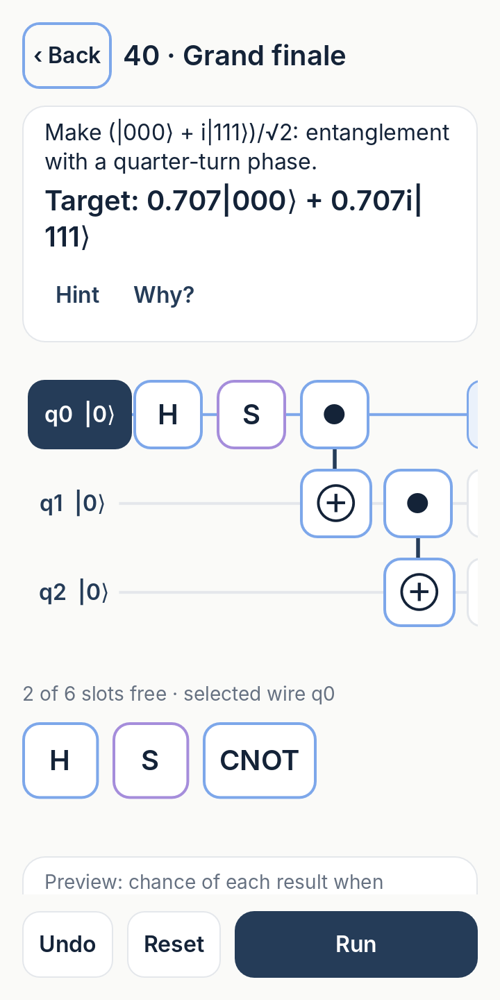<br><sub><b>Level 40.</b> Three entangled qubits with a quarter-turn phase.</sub></td>
  </tr>
  <tr>
    <td align="center">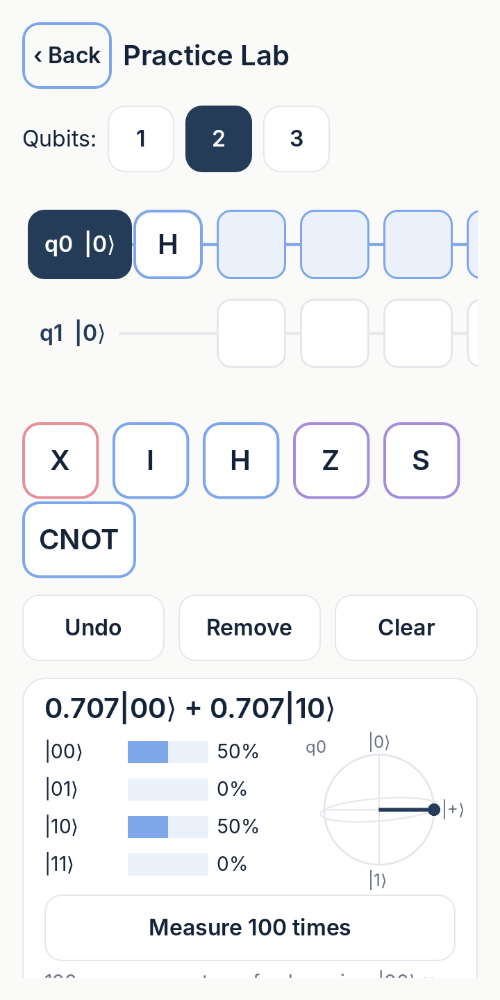<br><sub><b>Practice Lab.</b> Free experimentation, live ket, Bloch view, "Measure 100 times".</sub></td>
    <td align="center">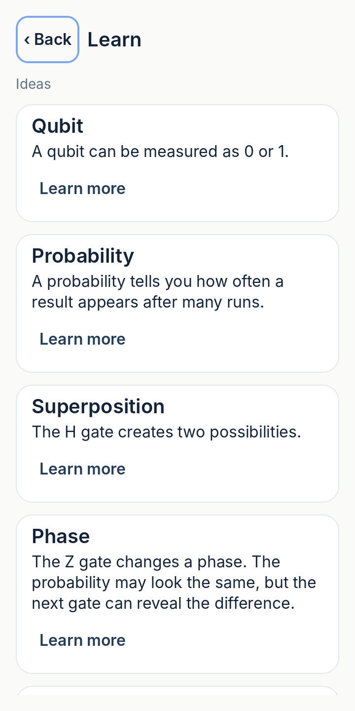<br><sub><b>Learn.</b> Short ideas with optional "Learn more" drawers.</sub></td>
    <td align="center">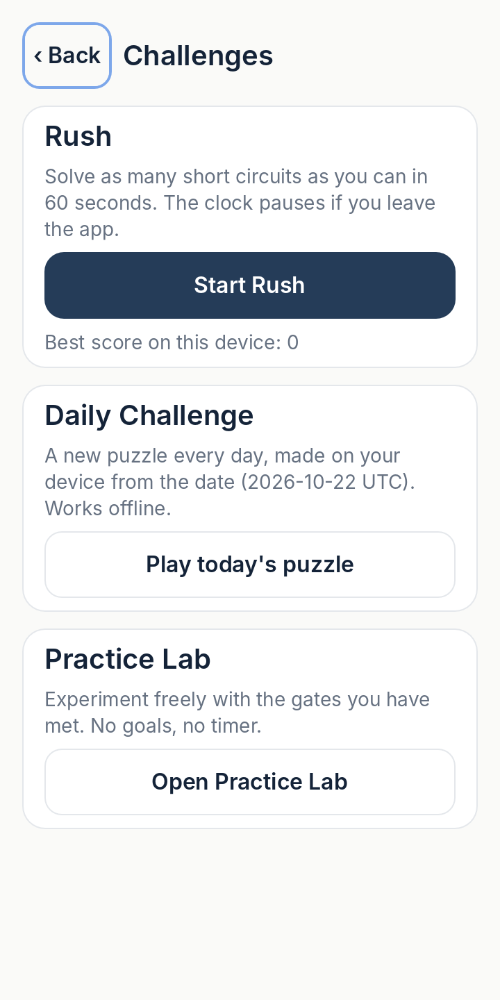<br><sub><b>Challenges.</b> Rush, Daily Challenge and Practice Lab.</sub></td>
  </tr>
  <tr>
    <td align="center">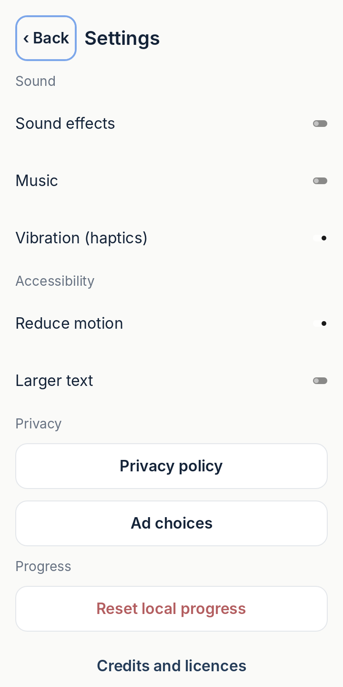<br><sub><b>Settings.</b> Sound, haptics, reduce motion, larger text, privacy.</sub></td>
    <td></td>
    <td></td>
  </tr>
</table>

---

## The quantum mechanics inside

Everything below is exactly what the simulator in [`scripts/core/`](scripts/core/) computes. Amplitudes are stored in double precision, and the game supports up to 3 qubits.

### A qubit is a list of amplitudes

A single qubit is described by two complex numbers called **amplitudes**:

$$|\psi\rangle = a_0\,|0\rangle + a_1\,|1\rangle, \qquad |a_0|^2 + |a_1|^2 = 1$$

With $n$ qubits the state is a list of $2^n$ amplitudes, one per possible result. Every game starts from $|0\cdots0\rangle$.

### Gates are matrices

Each gate is a small matrix that multiplies the amplitudes:

$$X = \begin{pmatrix} 0 & 1 \\ 1 & 0 \end{pmatrix} \qquad Z = \begin{pmatrix} 1 & 0 \\ 0 & -1 \end{pmatrix} \qquad H = \frac{1}{\sqrt{2}}\begin{pmatrix} 1 & 1 \\ 1 & -1 \end{pmatrix}$$

The game also implements $I$, $Y$, $S$, $T$ and CNOT (flip the target qubit when the control qubit is 1). Gates unlock one at a time as the curriculum introduces them.

### Measurement: the Born rule

You never see amplitudes directly. When a qubit is measured, result $i$ appears with probability

$$P(i) = |a_i|^2$$

The probability bars in every puzzle show exactly these numbers. In the Practice Lab, "Measure 100 times" samples a fresh copy of the state each time, so measuring never changes the circuit you built.

### Superposition is not a 50/50 coin

After a Hadamard gate, $H|0\rangle = \tfrac{1}{\sqrt{2}}(|0\rangle + |1\rangle)$, and the qubit gives 0 or 1 half the time each. That looks like a fair coin, but it is not one. A coin is secretly heads or tails before you look. A superposition is a single definite state whose two amplitudes can still **interfere**: apply $H$ again and you get $|0\rangle$ every time. No coin flipped twice comes back to heads with certainty.

### Relative phase and interference: H–Z–H = X

$|+\rangle = \tfrac{1}{\sqrt{2}}(|0\rangle + |1\rangle)$ and $|-\rangle = \tfrac{1}{\sqrt{2}}(|0\rangle - |1\rangle)$ have identical probability bars, yet they are different states. The $Z$ gate turns one into the other by flipping the sign (the *phase*) of the $|1\rangle$ part. A following $H$ reveals the difference:

$$H\,Z\,H\,|0\rangle = H\,Z\,|+\rangle = H\,|-\rangle = |1\rangle$$

So H–Z–H acts exactly like X, and level 20 asks players to discover this. This is also why the game compares **states**, not bars. The win check uses the fidelity

$$F = |\langle \psi_{\text{target}} | \varphi_{\text{yours}} \rangle|^2 \ge 0.999$$

which ignores an unobservable global phase but catches every relative-phase mistake. Levels whose goal is a measurement distribution compare probabilities instead (total variation distance ≤ 0.01).

### Entanglement: a Bell pair from H + CNOT

Two qubits can share a state that cannot be split into "qubit A does this, qubit B does that". Applying H to qubit 0 and then CNOT gives

$$|00\rangle \xrightarrow{H \text{ on } q_0} \tfrac{1}{\sqrt{2}}(|00\rangle + |10\rangle) \xrightarrow{\text{CNOT } q_0 \to q_1} \tfrac{1}{\sqrt{2}}(|00\rangle + |11\rangle)$$

Each qubit alone is random, yet the two results always agree. In the Bloch view, an entangled qubit's arrow shrinks to zero: on its own it has no definite direction.

> **Ordering convention.** Qubit 0 is the top wire and the least significant bit of the basis index. Kets are written q0 first, so $|10\rangle$ means q0 = 1, q1 = 0. This convention is documented in [`docs/DECISIONS.md`](docs/DECISIONS.md) and covered by unit tests.

### Worked example 1: Level 1 "Reach |1⟩" ([`level_01.json`](data/levels/level_01.json))

- **Start:** $|0\rangle$. **Gates available:** X. **Slots:** 3. **Goal:** `state_fidelity` with target $|1\rangle$.
- **Tutorial:** "A qubit can be measured as 0 or 1. Reach |1⟩." Example $X|0\rangle = |1\rangle$, action "Tap X, then Run."
- **Math:** $X\begin{pmatrix}1\\0\end{pmatrix} = \begin{pmatrix}0\\1\end{pmatrix}$, so $F = 1$ and $P(1) = 100\%$.
- **Scoring:** 3 stars at 1 gate, 2 stars at 2 gates. Result text: "You made |1⟩. Nice work."

### Worked example 2: Level 30 "Bell pair" ([`level_30.json`](data/levels/level_30.json))

- **Start:** $|00\rangle$. **Gates available:** H, CNOT. **Slots:** 3. **Goal:** `bell_state` = `phi_plus`, i.e. $\tfrac{1}{\sqrt{2}}(|00\rangle + |11\rangle)$.
- **Tutorial:** "Two qubits can become linked in a way ordinary bits cannot."
- **Reference solution:** H on q0, then CNOT q0 → q1 (the derivation above). 3 stars at 2 gates.
- **Why panel:** "Each qubit alone is random, yet the two results always agree. That correlation is entanglement."

---

## Curriculum

40 handcrafted levels, each introducing at most one new idea. Every level ships with a free hint and an optional "Why?" explanation.

| Levels | Chapter | Concept | Gates introduced |
|---|---|---|---|
| 1–8 | Fundamentals | Basis states, flips, the identity, measurement probabilities, gate budgets | X, I |
| 9–16 | Fundamentals | Superposition, negative amplitudes, probability vs amplitude | H |
| 17–24 | Fundamentals | Relative phase, interference, H–Z–H = X, quarter-turn phases | Z, S |
| 25–32 | Entanglement | Second qubit, controlled flips, Bell pairs (including phase-sensitive ones) | CNOT |
| 33–40 | Algorithms | Global phase, singlet and GHZ states, eighth-turn phases, reversibility, efficiency | Y, T |

Goal types: `state_fidelity`, `measurement_distribution`, `bell_state`, `gate_efficiency`. Some levels also include locked, pre-placed gates (for example, "undo this flip").

### Game modes

| Mode | What it is |
|---|---|
| **Learn** | The 40-level curriculum, untimed. Play opens the next unfinished level directly. |
| **Rush** | Optional 60-second run of generated circuits (unlocks after level 10). The clock pauses when the app loses focus. |
| **Daily Challenge** | A new puzzle every day, generated on the device from the UTC date. Works offline and implies no global leaderboard. Unlocks after level 9. |
| **Practice Lab** | 1–3 qubits, every gate you have met, live state view and repeated measurement. No goals, no timer. |

---

## Engineering

### Architecture

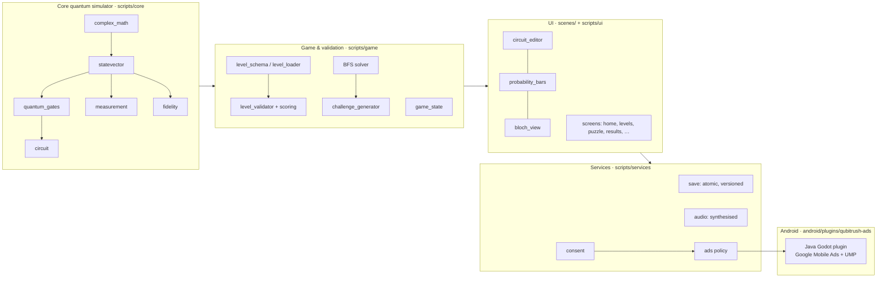

The simulator has no engine dependencies beyond plain data types, so it runs headlessly in unit tests. UI code only reads its results.

### Tech stack

| Area | Choice |
|---|---|
| Engine | Godot **4.7.2-stable**, GDScript, **Compatibility** (OpenGL ES 3) renderer |
| Platform | Android, portrait, minSdk **26** (Android 8.0), targetSdk **36**; arm64-v8a + armeabi-v7a (+ x86_64 in debug for emulators) |
| Build | Godot Gradle export (Gradle 8.11.1, AGP 8.6.1), JDK 17, `bundletool` validation for the AAB |
| Tests | GUT 9.7.1 (unit, integration, UI), headless solvability and performance scripts |
| CI | GitHub Actions: tests + APK build, then emulator smoke tests on API 36 and API 26 |
| Ads bridge | Small Java Godot plugin around Google Mobile Ads 25.5.0 and UMP 4.0.0 (test IDs only in the repo) |
| Fonts / audio | Inter (OFL) + a DejaVu subset for ⟨ ⟩. All sounds are synthesised in code |

### Project structure (trimmed)

```
project.godot · export_presets.cfg
scenes/                 home, level_select, puzzle, results, settings, practice, consent, rush
scripts/
  core/                 complex_math, statevector, quantum_gates, measurement, fidelity, circuit
  game/                 level_schema, level_loader, level_validator, scoring, solver, challenge_generator
  ui/                   app_theme, circuit_editor, gate_button, probability_bars, bloch_view
  services/             save, audio, consent, ads (+ providers), analytics (local only)
data/levels/            level_01.json … level_40.json + index.json
android/plugins/        qubitrush-ads (Java, Gradle)
tests/                  unit/, integration/, ui/, check_levels.gd, perf_check.gd
.github/workflows/      android-emulator.yml
docs/ · reports/        spec, decisions, compliance, verification evidence
```

### Key design decisions

- **Pure, headless-testable simulator.** Amplitudes are interleaved double-precision arrays (Godot's `Vector2` is single precision), and the gates are unit-tested against their defining identities (X² = I, H² = I, S² = Z, T² = S, HZH = X, …).
- **Explicit qubit-ordering convention** (q0 = top wire = least significant bit), documented and tested so that kets, wires and CNOT directions never disagree.
- **Every level is proven solvable.** A breadth-first search solver independently solves all 40 levels. Each level's 3-star threshold must *equal* the optimal gate count, and no level may be solvable by an empty circuit.
- **Offline-first.** Progress is saved locally with atomic writes, a backup file, schema migrations and corruption recovery. In-progress circuits survive backgrounding and process death.
- **Child-safe ads policy by default.** Ads are opt-in, never shown during gameplay, and limited to non-personalised, G-rated, child-directed requests. Interstitials are disabled and the advertising-ID permission is removed from the build.
- **Compatibility renderer** for the widest range of Android devices, 2D only, with a "Reduce motion" setting.

More detail: [`docs/DECISIONS.md`](docs/DECISIONS.md), [`docs/LEVEL_FORMAT.md`](docs/LEVEL_FORMAT.md), [`docs/ADS_INTEGRATION.md`](docs/ADS_INTEGRATION.md).

---

## Quality & verification

The project follows a written build–test–fix–verify protocol with quality gates A–F (see [`docs/SPEC.md`](docs/SPEC.md) §17). Evidence lives in [`reports/`](reports/).

**Automated tests** (from [`reports/test-results.json`](reports/test-results.json)): **94 tests, 0 failures, 0 skipped; 4,630 / 4,630 assertions passed.**

| Suite | Tests |
|---|---|
| Quantum core (gates, identities, Bell state, norm, phase, seeded measurement) | 26 |
| Levels (schema, validator, scoring, solver, daily challenge) | 18 |
| Save service (persistence, migration, corruption recovery) | 12 |
| Ads policy (consent, idempotent rewards, no ads in gameplay) | 19 |
| Gameplay flow (first run offline, all 40 levels end to end, pause/resume) | 15 |
| UI layout (5 screen sizes incl. tablet and large text, 48 dp touch targets) | 4 |

**Level solvability** ([`reports/level-solvability.json`](reports/level-solvability.json)): **40 / 40** levels load, are solved by their reference solution and by the independent solver, and have 3-star thresholds equal to the optimum.

**CI emulator smoke test** ([`android-emulator` workflow](https://github.com/MariaAlejandraBoadaRodriguez/QUBIT-RUSH/actions/workflows/android-emulator.yml)): [run #3](https://github.com/MariaAlejandraBoadaRodriguez/QUBIT-RUSH/actions/runs/39720349019) passed the build-and-test job and the emulator jobs on **API 36 and API 26**. Each emulator job installs the debug APK, launches it and runs Play → place X → Run → Results → Next level, then backgrounds and resumes the app. It checks the screenshots for the real design colours and fails on any crash, ANR or Godot error in logcat.

**Performance** (headless, [`reports/performance.json`](reports/performance.json); container measurements, not device benchmarks):

| Metric | Result | Budget |
|---|---|---|
| Run a 3-qubit, 20-gate circuit | 0.18 ms | 2 ms |
| Live preview refresh | 0.05 ms | 2 ms |
| Load and validate all 40 levels | 5.7 ms | 500 ms |
| BFS-solve all 40 levels | 30 ms | 20 s |
| Object growth after 600 puzzle open/close cycles | +12 objects | ≤ 200 |

**Quality gates** ([`reports/FINAL_VERIFICATION.md`](reports/FINAL_VERIFICATION.md)):

| Gate | Status |
|---|---|
| A · Quantum correctness | PASS |
| B · Content completeness (40 solvable levels) | PASS |
| C · Gameplay integration | PASS (headless) |
| D · Ads safety | PASS (policy logic with a mock SDK) |
| E · Android delivery | APK and AAB build. The emulator smoke test now passes in CI (run #3 above); the verification report was written before CI access and still lists this gate as blocked |
| F · Full regression | PASS |

**Not yet verified**

- Physical devices (low-end and mid-range phones), TalkBack and real-hardware rendering.
- Live AdMob test ads and the Google consent form on a device. Production ads are not configured.
- Signed release AAB, Google Play upload, Families-policy review and the Data safety form.

---

## Privacy & ethics

- **No login, no account, no email, no data collection.** Progress stays on the device and can be erased from Settings.
- **Fully offline.** Every level, tutorial and mode works without internet.
- **No ads during gameplay, tutorials or timers.** Ads are off unless the player opts in. The only offer is an optional rewarded hint on the results screen, and a basic hint is always free.
- **Child-safe defaults.** Ads use child-directed, under-age-of-consent and G-rated settings, with no personalisation and no interstitials. The advertising-ID permission is removed from the build.
- **Honest science.** Every result comes from the real mathematics. The game never claims that a single measurement proves a state.

See [`data/privacy_policy.txt`](data/privacy_policy.txt) (draft, pending legal review) and [`docs/COMPLIANCE.md`](docs/COMPLIANCE.md).

---

## Run it yourself

**Prerequisites:** Linux or macOS shell, JDK 17, Godot 4.7.2 with export templates, Android SDK (platform 36, build-tools 36.1.0). On Linux, one script installs all of it:

```bash
bash scripts/setup-env.sh && source ~/.bashrc
```

**Import, test and verify**

```bash
~/tools/godot --headless --path . --import                              # import the project
~/tools/godot --headless --path . -s addons/gut/gut_cmdln.gd -gexit     # unit + integration + UI tests
~/tools/godot --headless --path . -s tests/check_levels.gd              # prove all 40 levels solvable
~/tools/godot --path .                                                  # play on desktop
```

**Build the debug APK**

```bash
bash scripts/install-android-template.sh     # Godot Gradle build template
bash scripts/build-android-plugin.sh         # ads bridge AARs
~/tools/godot --headless --path . --export-debug "Android" build/qubit-rush-debug.apk
```

**Install on an Android Studio emulator**

1. In Android Studio, open **Device Manager** and start a virtual device (Android 8.0 / API 26 or newer).
2. Drag `build/qubit-rush-debug.apk` onto the running emulator window. It installs automatically.
3. Open **Qubit Rush** from the app drawer. Or install from a terminal with `adb install -r build/qubit-rush-debug.apk`.

The full regression (tests, solvability, performance, APK, AAB validation) runs with `bash scripts/run-all-checks.sh`.

---

## Roadmap

- **Google Play release:** signed AAB, a closed testing track, the store listing and the target-audience/Families decision.
- **Localization:** UI strings are already extracted as translation keys. Spanish is the first target.
- **More levels and algorithms:** Deutsch's algorithm, Grover-style search puzzles and more three-qubit challenges.
- **Optional rewarded hints:** enable live, policy-reviewed rewarded hints once the compliance decisions are recorded.

---

## Built with AI-assisted, spec-driven development

I wrote the product specification ([`docs/SPEC.md`](docs/SPEC.md)): the game design, the scientific-accuracy rules, the child-safety policy, and the quality gates A–F that define "done". Claude Code built the implementation under an autonomous build–test–fix–verify protocol that I designed, in which every change had to pass headless tests, the level-solvability proof and Android builds before being committed. I directed the work, set the acceptance criteria, reviewed the evidence, and required verification in CI on real Android emulators rather than accepting generated code at face value. The decisions log and verification reports in this repository are the audit trail of that workflow.

---

## About the author

**María Alejandra Boada Rodríguez**: software engineer and quantum computing science communicator from Colombia, currently studying for a Master's in Data Analytics at the University of Niagara Falls, Canada.

I care about making advanced technology understandable without making it less true. Qubit Rush brings both sides of that work together: careful engineering, and science communication that respects its audience.

- GitHub: [@MariaAlejandraBoadaRodriguez](https://github.com/MariaAlejandraBoadaRodriguez)

---

<sub>Licence: no licence file has been added yet, so all rights are reserved by default. Third-party components keep their own licences: Godot (MIT), GUT (MIT, development only), Inter (OFL 1.1), DejaVu subset, and Google Mobile Ads/UMP (Google terms).</sub>
